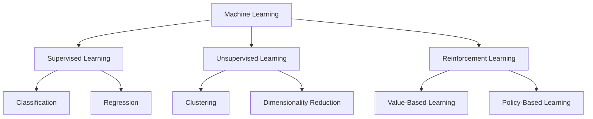

# Machine Learning Zero to Mastery 🚀

<p align="center">
  
  
  
</p>

Welcome to **Machine Learning Zero to Mastery!**

This repository is a beginner-friendly collection of Machine Learning concepts, algorithms, Python implementations, datasets, and practical examples.

The goal of this repository is to learn Machine Learning step by step, starting from the fundamentals and moving towards advanced concepts with practical implementation.

## 📌 Table of Contents

- [Introduction to Machine Learning](#-introduction-to-machine-learning)
- [Types of Machine Learning](#-types-of-machine-learning)
- [Machine Learning Algorithms](#-machine-learning-algorithms)
- [Machine Learning Workflow](#-machine-learning-workflow)
- [Technologies Used](#-technologies-used)
- [Getting Started](#-getting-started)
- [Learning Roadmap](#-learning-roadmap)
- [Support](#-support-this-project)

## 🤖 Introduction to Machine Learning

**Machine Learning (ML)** is a branch of Artificial Intelligence (AI) that enables computers to learn from data and make predictions or decisions without being explicitly programmed for every task.

Instead of writing rules manually, we provide data to a machine learning algorithm so that it can identify patterns and learn from them.

**Real-world examples:**

- Email Spam Detection
- Face Recognition
- Movie Recommendations
- Disease Prediction
- House Price Prediction
- Fraud Detection
- Self-Driving Cars

## 📚 Types of Machine Learning

Machine Learning is mainly divided into three types:

1. Supervised Learning
2. Unsupervised Learning
3. Reinforcement Learning

### Machine Learning Classification Graph



### 1. Supervised Learning

Supervised Learning is a type of machine learning where the model learns from **labeled data**.

The dataset contains input features and their correct outputs.

It has two main subtypes:

**A. Classification**

- Used to predict categories or classes.
- Example: Spam or Not Spam email prediction.
- Algorithms:
  - Logistic Regression
  - Decision Tree Classifier
  - Random Forest Classifier
  - Support Vector Machine (SVM)
  - K-Nearest Neighbors (KNN)
  - Naive Bayes

**B. Regression**

- Used to predict continuous numerical values.
- Example: House price prediction.
- Algorithms:
  - Linear Regression
  - Polynomial Regression
  - Decision Tree Regressor
  - Random Forest Regressor
  - Support Vector Regression (SVR)

### 2. Unsupervised Learning

Unsupervised Learning is a type of machine learning where the model learns from **unlabeled data**.

It identifies hidden patterns, similarities, and relationships in the dataset.

Main subtypes:

**A. Clustering**

- Groups similar data points together.
- Algorithms:
  - K-Means Clustering
  - Hierarchical Clustering
  - DBSCAN
  - Mean Shift

**B. Dimensionality Reduction**

- Reduces the number of features while preserving important information.
- Algorithms:
  - Principal Component Analysis (PCA)
  - Linear Discriminant Analysis (LDA)
  - t-SNE
  - UMAP

### 3. Reinforcement Learning

Reinforcement Learning is a type of machine learning where an **agent learns by interacting with an environment**.

The agent takes actions and receives rewards or penalties based on its actions.

Main approaches:

**A. Value-Based Learning**

- Learns the value of actions.
- Algorithms: Q-Learning, SARSA, Deep Q-Network (DQN).

**B. Policy-Based Learning**

- Learns a strategy for choosing actions.
- Algorithms: REINFORCE.

**Example:** Training a robot to navigate an environment or teaching an AI to play a game.

## 🧠 Machine Learning Algorithms

This repository covers the following algorithms:

| Algorithm              | Type                   | Purpose                       |
| ---------------------- | ---------------------- | ----------------------------- |
| Linear Regression      | Supervised             | Predict numerical values      |
| Logistic Regression    | Supervised             | Classification                |
| Decision Tree          | Supervised             | Classification and Regression |
| Random Forest          | Supervised             | Classification and Regression |
| Support Vector Machine | Supervised             | Classification and Regression |
| K-Means Clustering     | Unsupervised           | Group similar data points     |
| PCA                    | Unsupervised technique | Dimensionality Reduction      |

### 📂 Algorithm Implementations

Explore the algorithm folders:

| Algorithm              | Folder                                  |
| ---------------------- | --------------------------------------- |
| Linear Regression      | [View Folder](./Linear%20Regression/)   |
| Logistic Regression    | [View Folder](./Logistic%20Regression/) |
| Decision Tree          | [View Folder](./Decision%20Tree/)       |
| Random Forest          | [View Folder](./Random%20Forest/)       |
| Support Vector Machine | [View Folder](./SVM/)                   |
| K-Means Clustering     | [View Folder](./KMeans/)                |
| Datasets               | [View Folder](./Datasets/)              |

## 🔄 Machine Learning Workflow

A typical Machine Learning project follows these steps:

1. **Data Collection:** Collect the required dataset.
2. **Data Preprocessing:** Handle missing values, duplicates, and incorrect data.
3. **Exploratory Data Analysis (EDA):** Understand the dataset using statistics and visualizations.
4. **Feature Engineering:** Select or create useful features.
5. **Model Selection:** Choose a suitable machine learning algorithm.
6. **Model Training:** Train the model using training data.
7. **Model Evaluation:** Evaluate performance using suitable metrics.
8. **Prediction:** Use the trained model to predict results.

## 🛠️ Technologies Used

- **Python** – Programming language
- **NumPy** – Numerical computations
- **Pandas** – Data manipulation and analysis
- **Matplotlib** – Data visualization
- **Seaborn** – Statistical data visualization
- **Scikit-learn** – Machine Learning algorithms
- **Jupyter Notebook** – Interactive coding and experimentation

## 🚀 Getting Started

Follow these steps to explore the repository on your local machine.

### 1. Clone the Repository

```bash
git clone https://github.com/KarthikJ-2008/Machine-Learning-Zero-to-Mastery.git
```

### 2. Navigate to the Project Folder

```bash
cd Machine-Learning-Zero-to-Mastery
```

### 3. Install Required Libraries

```bash
pip install numpy pandas matplotlib seaborn scikit-learn jupyter
```
### 4. Update Dataset Paths
Before running the notebooks, update the dataset file paths to match the location where you downloaded or stored the datasets on your computer.

This is important because the original dataset paths may not match your local folder structure.

### 5. Run Jupyter Notebook

```bash
jupyter notebook
```

Open the notebooks and explore the implementations.

## 🎯 Learning Roadmap

A suggested path for learning Machine Learning:

- [ ] Learn Python fundamentals
- [ ] Learn NumPy and Pandas
- [ ] Understand data visualization
- [ ] Learn data preprocessing
- [ ] Understand supervised learning
- [ ] Practice regression algorithms
- [ ] Practice classification algorithms
- [ ] Learn unsupervised learning
- [ ] Practice clustering algorithms
- [ ] Learn dimensionality reduction
- [ ] Understand model evaluation
- [ ] Build real-world Machine Learning projects

## ⭐ Support This Project

If you find this repository helpful for learning Machine Learning:

- ⭐ **Star this repository** to show your support.
- 🍴 **Fork this repository** to explore and improve the code.
- 👤 **Follow me on GitHub** for more projects, tutorials, and updates.

Your support motivates me to keep learning, building, and sharing more projects!

**Let's learn Machine Learning together! 🚀**

---

##  Connect With Me

**GitHub:** [KarthikJ-2008](https://github.com/KarthikJ-2008)